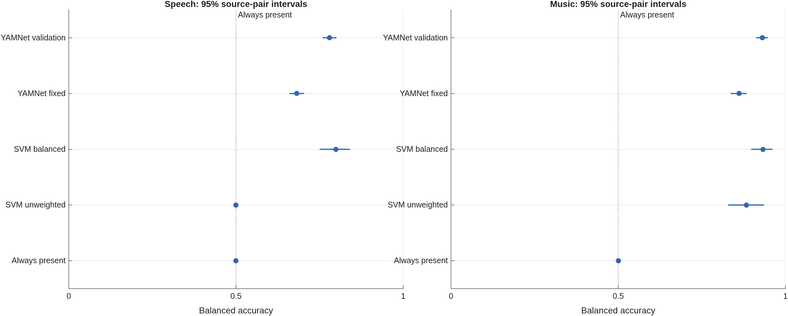
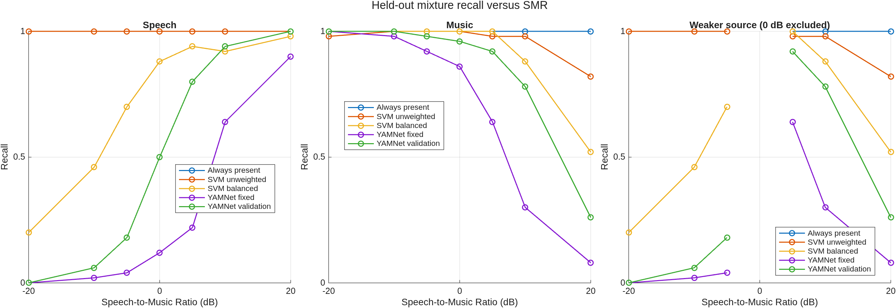

# Final results

The [reserved final run](https://github.com/49sky/elec5305-project-530582937/actions/runs/43222393874)
completed successfully on 13 November 2026 (Sydney). The experiment and result
publication jobs both passed. The tested code revision was
`0c6afb50819cc59d2779f6e879e21cb49471a556`, using MATLAB R2026b Update 1.

## Protocol and checks

The fixed protocol used 100 training pairs, 30 validation pairs and 50 test
pairs, with central two-second, mono, 16 kHz excerpts. Seven SMRs from -20 to
+20 dB gave 900 training, 270 validation and 450 test examples. The test set
contained 350 mixtures, 50 speech-only and 50 music-only examples: 400 positives
and 50 negatives for each output.

The test files were exactly indices 11-60 of each type in the archived split.
Their paths did not overlap training, validation or the original preliminary
test files. Confusion counts and balanced accuracies were checked against the
saved decisions. Model settings came from validation data. The selected C was
0.01 for both speech SVMs, 1 for unweighted music and 0.1 for balanced music.
YAMNet selected 0.05 for each target. Its recorded output layer was
`nnet.cnn.layer.SoftmaxLayer`, with 521 classes. The final test was not used to
retune these choices.

## Overall performance

Balanced accuracy is the primary measure. F1 below is for the present class.

| System | Speech balanced accuracy | Speech F1 | Music balanced accuracy | Music F1 |
| --- | ---: | ---: | ---: | ---: |
| Always present | 0.5000 | 0.9412 | 0.5000 | 0.9412 |
| SVM unweighted | 0.5000 | 0.9412 | 0.8838 | 0.9711 |
| SVM balanced | 0.7988 | 0.8523 | 0.9325 | 0.9573 |
| MATLAB YAMNet, fixed 0.5 | 0.6813 | 0.5321 | 0.8613 | 0.8389 |
| MATLAB YAMNet, validation thresholds | 0.7800 | 0.7179 | 0.9313 | 0.9262 |

The unweighted speech SVM labelled every example as speech-present. Its 0.9412
F1 therefore matches the always-present reference, despite rejecting none of
the 50 negatives. Class balancing recovered 42 true negatives at the cost of
97 missed positives. Specificity rose from zero to 0.84 and balanced accuracy
rose to 0.7988, while positive-class F1 fell. This is why F1 alone gives an
incomplete account of this design, which has eight positives per negative.

For music, balancing reduced false alarms from ten to three and increased
misses from 13 to 30. Specificity improved from 0.80 to 0.94; recall fell from
0.9675 to 0.9250. Balanced accuracy improved, with a smaller loss in F1.

Validation-selected YAMNet thresholds recovered 79 speech-positive and 56
music-positive examples compared with the fixed rule. Both rules had zero
observed false positives among the 50 negatives for each target. Those counts
describe this source selection and do not establish a zero false-alarm rate
on other recordings.

The balanced SVM had the highest balanced-accuracy point estimates for both
targets. Its music result, 0.9325, was very close to validation-threshold
YAMNet's 0.9313. The comparison applies to the source selection and processing used here.

## Paired uncertainty

The same 2,000 source-pair resamples were used for every system. The table
reports paired balanced-accuracy changes in percentage points, rounded to one
decimal place. Exact values are in the
[paired comparison CSV](../results/final/preliminary_paired_comparisons.csv).

| Modification | Speech change (95% interval) | Music change (95% interval) |
| --- | ---: | ---: |
| Balanced minus unweighted SVM | +29.9 (+25.0 to +34.1) | +4.9 (+0.3 to +10.1) |
| Selected minus fixed YAMNet threshold | +9.9 (+8.1 to +11.8) | +7.0 (+5.5 to +8.4) |

Both modifications improved balanced accuracy on this final set, with the
paired percentile intervals above zero. The intervals hold the trained models
and selected thresholds fixed. They describe test-pair variation, with no
allowance for retraining or choosing thresholds from a different validation
sample. The zero-width reference intervals arise from constant predictions
and fixed class counts per pair. Recordings by the same speaker or artist
may also remain related.

## Effect of relative level

The table shows mixture recall for the balanced SVM and validation-threshold
YAMNet. Each entry uses the same 50 test pairs.

| SMR (dB) | SVM speech | YAMNet speech | SVM music | YAMNet music |
| --- | ---: | ---: | ---: | ---: |
| -20 | 0.20 | 0.00 | 1.00 | 1.00 |
| -10 | 0.46 | 0.06 | 1.00 | 1.00 |
| -5 | 0.70 | 0.18 | 1.00 | 0.98 |
| 0 | 0.88 | 0.50 | 1.00 | 0.96 |
| +5 | 0.94 | 0.80 | 1.00 | 0.92 |
| +10 | 0.92 | 0.94 | 0.88 | 0.78 |
| +20 | 0.98 | 1.00 | 0.52 | 0.26 |

Speech detection generally improved as speech became stronger, while music
detection declined as music became weaker. At -20 dB, the balanced SVM found
speech in ten of 50 mixtures and YAMNet found none. At +20 dB, music was found
in 26 mixtures by the SVM and 13 by YAMNet. Threshold selection helped YAMNet
but did not remove the weak-source problem.

The unweighted speech curve remains at recall one because every clip was
accepted. High recall needs to be read alongside specificity. The weaker-source
curve excludes 0 dB because neither source is weaker at equal power.

## Interpretation and limits

The fixed 0.5 YAMNet comparison uses the MATLAB softmax implementation, as
documented in the [method notes](methods.md). Its class scores share a total
of one, constraining simultaneous detection at that threshold. The TensorFlow
reference uses independent sigmoid outputs. The MATLAB head stayed fixed throughout the comparison.

The SVM weighting effect differed from the small development experiment. The
final protocol also changed training/validation counts, source selections and
SMR coverage. The two runs cannot isolate which of those changes explains the
difference. Within the final run, weighting and threshold rules were compared
on matched examples with validation-only selection.

The findings apply to controlled mixtures and source-track labels. Vocal music,
pauses in speech excerpts, file-level rather than speaker/artist-level splits,
and the absence of silence/noise-only controls limit broader interpretation.
The saved error-case table identifies clips for listening alongside the
source labels.

The study supports two practical conclusions within this protocol: class
balance and decision thresholds materially affect the comparison, and both
representations miss sufficiently weak sources. It does not establish
performance on natural, uncontrolled mixtures.

## Saved outputs

[Final CSVs, manifests and plots](https://github.com/49sky/elec5305-project-530582937/tree/main/results/final) contain the measured
results. The successful workflow also provides `final-handcrafted-models`,
`final-results` and `presence-demo` artifacts. The small demo contains pair 11
at all seven SMRs and its two pure-source controls, with source credits.
The source selection, features, training rules and thresholds are fixed by
the recorded protocol. Later reproductions use separate output directories.
